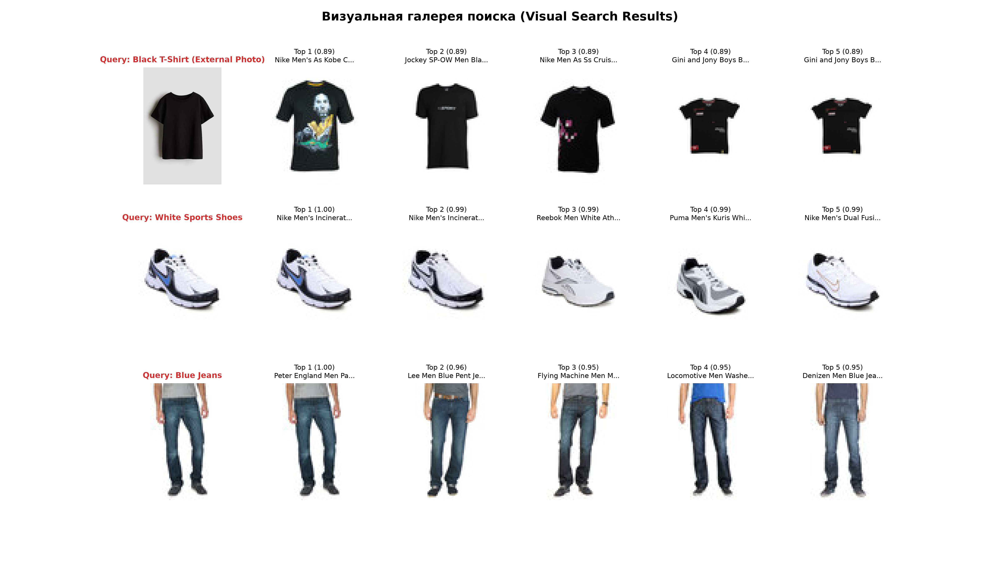
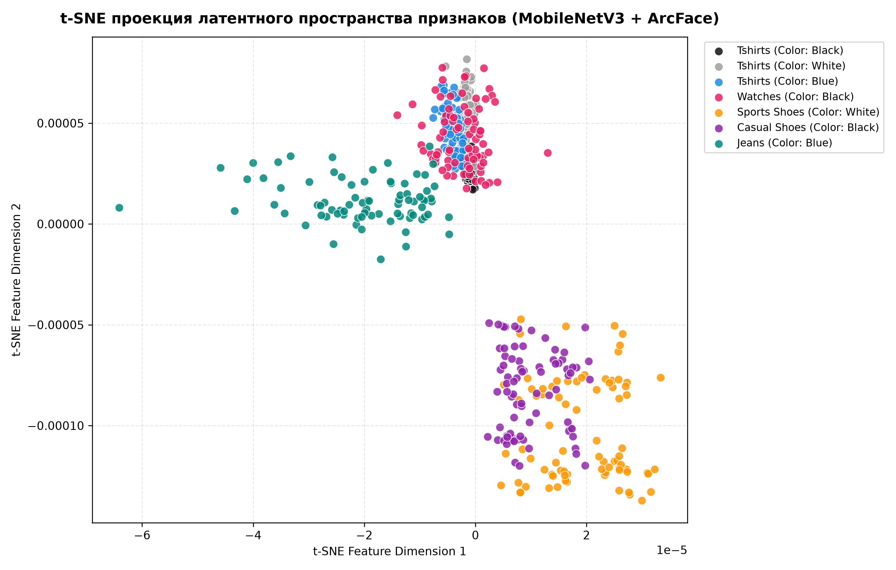
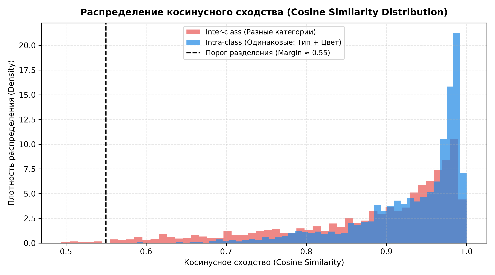
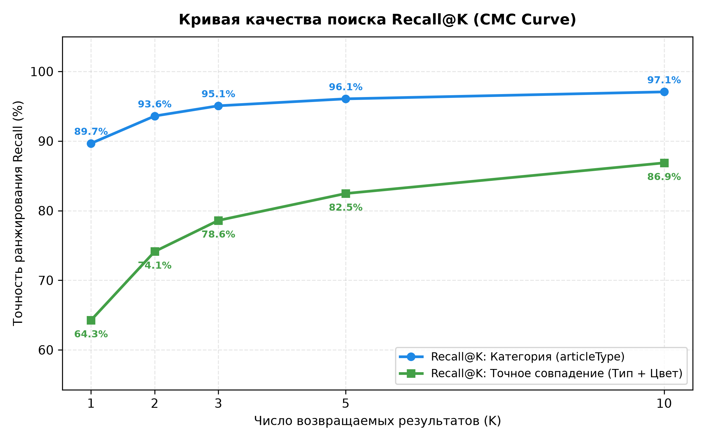

# Visual Search Engine for Fashion (Движок визуального поиска одежды)

Сервис визуального поиска одежды по фотографии на основе глубокого обучения, метрического обучения (Metric Learning / ArcFace) и векторного поиска FAISS.

Пользователь загружает фото предмета гардероба (например, черную футболку, кроссовки или платье), нейросеть извлекает 512-мерный вектор признаков (эмбеддинг), а векторный индекс за миллисекунды находит наиболее похожие товары из каталога с учетом типа одежды, силуэта и цвета.

---

## Архитектура решения

```
  [ Изображение запроса ]
             │
             ▼
  [ Препроцессинг: 224x224, ImageNet Norm ]
             │
             ▼
  [ ONNX Runtime: MobileNetV3-Small ] ────► L2-нормализованный эмбеддинг (512-d)
             │
             ▼
  [ FAISS Index (IndexFlatIP) ] ──────────► Поиск ближайших векторов (косинусное сходство)
             │
             ▼
  [ catalog_meta.csv ] ──────────────────► Сопоставление с метаданными товара
             │
             ▼
  [ JSON-ответ с Top-K товарами ]
```

### Ключевые особенности ML-пайплайна:
* **Бэкбон:** `MobileNetV3-Small` — легковесная и быстрая сверточная сеть, оптимизированная для CPU и мобильных устройств.
* **Функция потерь:** **ArcFace (Additive Angular Margin Loss)** с марджином $m = 0.30$.
* **Целевые классы:** сшитые метки `articleType + "_" + baseColour` (например, `Tshirts_Black`, `Shoes_White`). Это гарантирует, что модель разделяет одежду не только по силуэту, но и строго учитывает цвет.
* **Инференс:** экспорт в формат **ONNX** с динамическим батчем и запуск через **ONNX Runtime (CPUExecutionProvider)**.
* **Векторная база:** **FAISS (`IndexFlatIP`)** для мгновенного поиска по косинусному сходству нормализованных векторов.

---

## Структура проекта

```
.
├── main.py                 # FastAPI веб-сервер с эндпоинтом /search
├── build_index.py          # Построение векторного индекса FAISS и метаданных каталога
├── export_onnx_file.py     # Экспорт обученных весов PyTorch (.pth) в формат ONNX
├── evaluate_metrics.py     # Скрипт оценки качества поиска (Top-1 Accuracy, Top-5 Precision)
├── check_result.py         # Визуализация найденных товаров с помощью Matplotlib
├── make_presentation.py    # Скрипт генерации графиков презентации и сборки val_data
├── presentation/           # Папка с графиками и визуализациями результатов
│   ├── 1_search_gallery.png
│   ├── 2_tsne_clusters.png
│   ├── 3_similarity_distribution.png
│   └── 4_recall_at_k.png
├── val_data/               # Автономный локальный мини-датасет для валидации (300 фото)
│   ├── images/
│   └── labels.csv
├── pictures/               # Тестовые изображения для проверки поиска
├── requirements.txt        # Список зависимостей проекта
├── .gitignore              # Исключения для Git (модели, индексы, кэш)
├── mobilenet_v3_embedding.pth  # Обученные веса модели PyTorch (локально)
├── visual_search.onnx      # Экспортированная ONNX-модель
├── fashion_catalog.index   # Построенный бинарный индекс FAISS
└── catalog_meta.csv        # Таблица метаданных каталога товаров
```

---

## Установка и настройка

### 1. Клонирование репозитория и создание окружения
```bash
git clone <URL_РЕПОЗИТОРИЯ>
cd <ИМЯ_ПАПКИ>

python3 -m venv .venv
source .venv/bin/activate  # Для macOS/Linux
# .venv\Scripts\activate   # Для Windows
```

### 2. Установка зависимостей
```bash
pip install --upgrade pip
pip install -r requirements.txt
```

---

## Пошаговый пайплайн работы

### Шаг 1. Обучение модели
Обучение проводится в Google Colab или локально с GPU/MPS на датасете `ashraq/fashion-product-images-small`.
* Модель обучается разделять сшитые классы `articleType + baseColour`.
* Аугментация использует `hue=0.0`, чтобы сохранить цветовую семантику.
* На выходе сохраняется файл весов `mobilenet_v3_embedding.pth`.

### Шаг 2. Экспорт модели в ONNX
Конвертирует PyTorch-модель в легковесный ONNX-граф для быстрого CPU-инференса:
```bash
python export_onnx_file.py
```
*Создается файл:* `visual_search.onnx`.

### Шаг 3. Построение индекса каталога товаров
Скачивает датасет каталога, извлекает эмбеддинги для всех товаров и строит базу поиска:
```bash
python build_index.py
```
*Создаются файлы:* `fashion_catalog.index` и оптимизированный `catalog_meta.csv`.

### Шаг 4. Запуск API сервиса
Запуск FastAPI приложения через Uvicorn:
```bash
uvicorn main:app --reload --port 8000
```
После запуска доступны:
* **Swagger UI (интерактивная документация):** [http://127.0.0.1:8000/docs](http://127.0.0.1:8000/docs)
* **ReDoc:** [http://127.0.0.1:8000/redoc](http://127.0.0.1:8000/redoc)

---

## Использование API

### Эндпоинт `POST /search`
Принимает изображение товара и возвращает список похожих позиций.

**Параметры:**
* `file`: файл изображения (JPEG, PNG, WebP).
* `top_k` *(optional, default=5)*: количество возвращаемых товаров.

**Пример запроса через cURL:**
```bash
curl -X POST "http://127.0.0.1:8000/search?top_k=5" \
  -H "accept: application/json" \
  -H "Content-Type: multipart/form-data" \
  -F "file=@pictures/test_balck_tshirt.jpeg"
```

**Пример ответа:**
```json
{
  "results": [
    {
      "id": 7566,
      "productDisplayName": "Nike Men's As Kobe Comic Black T-shirt",
      "articleType": "Tshirts",
      "similarity_score": 0.8886
    },
    {
      "id": 27969,
      "productDisplayName": "Jockey SP-OW Men Black Active Innerwear Vest SP12",
      "articleType": "Innerwear Vests",
      "similarity_score": 0.8886
    },
    {
      "id": 9989,
      "productDisplayName": "Nike Men As Ss Cruiser Black T-Shirts",
      "articleType": "Tshirts",
      "similarity_score": 0.8871
    }
  ]
}
```

---

## Валидация и оценка качества

### Визуальная проверка результатов
Для наглядного отображения карточек товаров из ответа поиска запустите:
```bash
python check_result.py
```
Скрипт загружает изображения напрямую из локального кэша датасета и отрисовывает сетку найденных товаров с названиями и ID.

### Расчет метрик поиска (Accuracy & Precision)
Скрипт тестирует точность ранжирования на случайной выборке:
```bash
python evaluate_metrics.py
```
Вычисляет:
* **Top-1 Accuracy:** доля запросов, где первый же результат совпадает по категории с запросом.
* **Top-5 Precision:** доля запросов, где целевая категория присутствует в первой пятерке выдачи.

---

## Результаты и графики презентации

Все графики сгенерированы и сохранены в папку `presentation/`:

### 1. Визуальная галерея поиска (Visual Search Results)
Примеры работы поиска на внешних фотографиях и позициях из каталога:


### 2. t-SNE проекция латентного пространства признаков
Демонстрация кластеризации 512-мерных эмбеддингов для различных типов одежды и цветов:


### 3. Распределение косинусного сходства (ArcFace Margin)
Разделение внутриклассового сходства (Intra-class) и межклассового (Inter-class):


### 4. Кривая Recall@K (CMC Curve)
Оценка ранжирования на тестовой выборке из 1500 товаров:


| Метрика | Top-1 | Top-3 | Top-5 | Top-10 |
| :--- | :---: | :---: | :---: | :---: |
| **Категория товара (`articleType`)** | **89.7%** | **95.1%** | **96.1%** | **97.1%** |
| **Точное совпадение (`Тип + Цвет`)** | **64.3%** | **78.6%** | **82.5%** | **86.9%** |

